<div align="center">


### Tomorrow starts with you.

**TOMORA** is personal future intelligence: explore the futures your choices could create, talk with a **future-self persona** grounded in your real circumstances, compare clearly different paths, and turn the one you choose into a plan you can act on.

[](#-nemotron-native-not-just-a-chat-endpoint)
[](#-deploy-it)
[](#-the-agent-works-on-its-own)
[](#-under-the-hood)
[](#memory-vault)
[](LICENSE)

### ▶ [**Try it live: tomora-ai.duckdns.org**](https://tomora-ai.duckdns.org)

Open the link, press **Use it** on the sign-in page, and you get a private workspace of your own in two clicks. No account, nothing to install.

**Nebius × NVIDIA Global AI Hackathon 2026 · Personal AI track**

[What it is](#-what-it-is) · [How it works](#-how-it-works) · [Brand](#-the-tomora-brand) · [Voice twin](#-the-standout-your-voice-twin) · [Share it](#-share-it-a-private-future-self-for-everyone) · [Agents](#-the-agent-works-on-its-own) · [Nemotron](#-nemotron-native-not-just-a-chat-endpoint) · [Features](#-every-feature) · [Deploy](#-deploy-it) · [What's next](#-whats-next)

<br/>

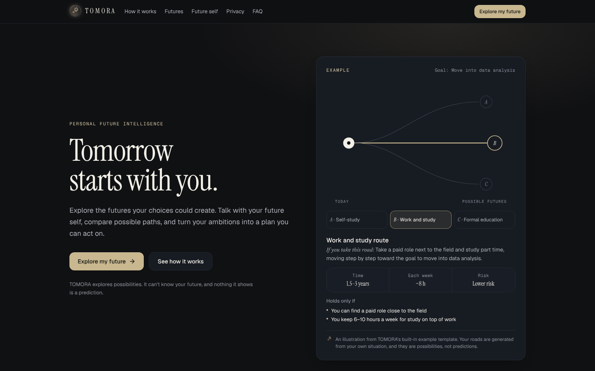

</div>

---

## ✨ What it is

Most AI assistants answer the question you just asked. TOMORA starts from the question you rarely ask: **who could you become, and which road there fits the life you actually have?**

TOMORA follows one journey: **understand me → explore futures → compare paths → choose a direction → take action → review progress → adapt.**

- 🧭 **Explore futures.** The Future Simulator lays out 6 to 12 clearly different roads to a goal (how you'd learn, pay and where), each with time and cost ranges, the assumptions it depends on, risks and first steps.
- ⚖️ **Compare with real numbers.** Every road is rated against your money, hours, dependants and risk tolerance in plain code, so "what if I only have five hours a week?" or "what if the first milestone slips?" recalculates instantly, marked **Recalculated**, without another model call.
- 💬 **Talk with your future self**, an AI persona that cites the notes it used, keeps what you told it apart from what it assumes, names trade-offs, and never claims to know your future.
- 🗺️ **Turn it into action**: plans, milestones and tasks, only after you approve them, with checkpoints and warning signs on the road you chose.
- 🌙 **Keep going when you don't**: a night shift writes your morning brief, a council of future selves debates hard decisions, missions split a big goal across helper agents.
- 📞 **Hear it in your own voice** (where a voice engine is configured), with recorded consent.
- 🔐 **Stay in control**: memory is a Markdown vault you can read, edit and delete; keys stay on the server; every change waits on an approval card.

> **Possibility over prediction.** TOMORA explores possibilities. It can't know your future, and nothing it shows is a prediction. Every scenario is conditional ("if you take this road and these assumptions hold"), every number is a range, and the arithmetic is deterministic and tested.

<div align="center">
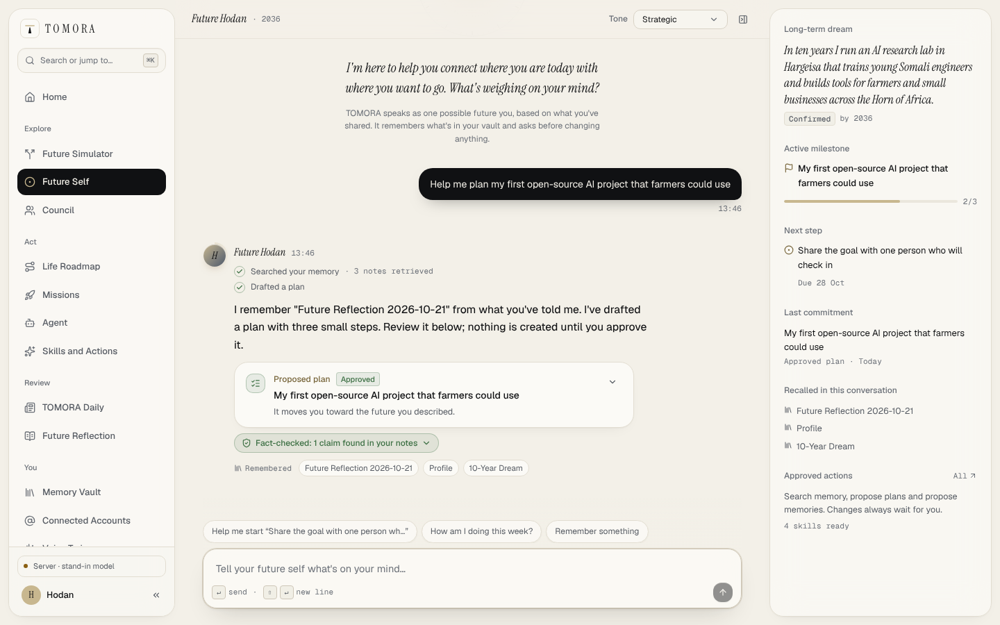
<br/><sub><b>Future Self.</b> Replies stream, tool calls show as they run, recalled notes are cited, and the plan waits as an approval card.</sub>
</div>

---

## 🧭 How it works

One journey, four steps, and every screen in the app serves one of them. The welcome page plays it as an interactive tour: the steps sit on a lit rail and advance by themselves (pausing while you point at them), and a glass screen acts each one out.

<div align="center">
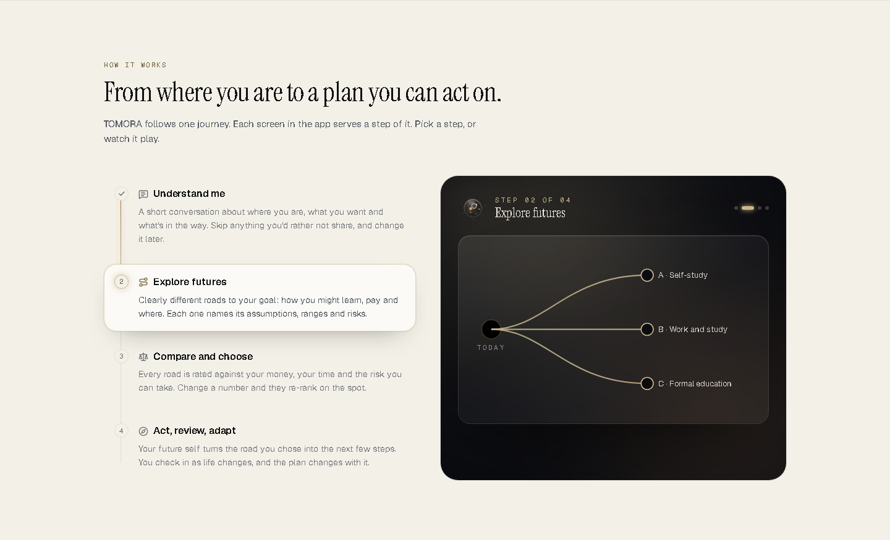
</div>

| Step | What happens | Where in the app |
| --- | --- | --- |
| **1 · Understand me** | A short conversation about where you are, what you want and what's in the way. Skip anything; change it later. It's saved as notes you can read, edit or delete. | Onboarding, Settings, Memory Vault |
| **2 · Explore futures** | Clearly different roads to your goal (how you might learn, pay and where), each naming its assumptions, ranges and risks. | Future Simulator, Future Reflection |
| **3 · Compare and choose** | Every road is rated against your money, your time and the risk you can take. Change a number and they re-rank on the spot, with plain arithmetic, not another model call. | Future Simulator, Council |
| **4 · Act, review, adapt** | Your future self turns the road you chose into the next few steps, which wait for your approval. You check in as life changes, and the plan changes with it. | Future Self, Life Roadmap, TOMORA Daily, Voice Twin |

The tour's scenes are illustrations with fixed example data (`src/features/landing/journey.tsx`); nothing on the welcome page calls a model.

---

## 🪞 The TOMORA brand

| | |
| --- | --- |
| **Name** | TOMORA · Personal Future Intelligence |
| **Tagline** | Tomorrow starts with you. |
| **Promise** | Explore the futures your choices could create. |
| **Symbol** | **The living mark.** An old clock where the past and the future turn together (a bronze ring of the past turns backward, the future dial forward, around today as a bronze point and the future you named as a champagne ring), set inside a glass sphere with lights on three tilted orbits. It **tilts toward your pointer**, its layers shift with depth, and today's point **looks at the cursor like an eye** and pulses. On Home and Future Self it sits as far along its trajectory as the share of your planned tasks that are done, and it spins up while your future self is answering. The same mark is the logo everywhere, down to the 28-pixel sidebar icon. `src/components/brand/living-mark.tsx` (`LivingMark`, `LivingEmblem`), pointer tracking in `use-gaze.ts`, the icon-size `Mark` and still `ClockFace` in `mark.tsx`, and `src/app/icon.svg` for the favicon. |
| **Palette** | Ink `#101113`, deep midnight `#171B22`, warm ivory `#F3F0E8`, muted champagne `#C8B78F` (used sparingly for the one important action and selected states), slate `#858A93`. Tokens in `src/app/globals.css`, raw values in `src/lib/brand.ts`. |
| **Type** | Instrument Serif for the wordmark and editorial headings, Geist for interface text, Newsreader for long-form reading, all self-hosted through `next/font`. |
| **Motion** | **Onboarding is a night scene:** aurora light that follows the steps, turning time rings, rising embers, a frosted-glass form with a light running round its edge, a live preview of your future self as you type, and the living mark carrying today toward the future with each answer. When you finish, they meet. **The welcome page** opens on the same night sky with the large living mark, floating glass cards, a gradient headline and a glowing call to action. Everything respects reduced-motion settings (OS or Settings → Appearance); on touch screens, with no pointer to follow, the mark drifts on its own. |

Everything brand-facing reads from **`src/lib/brand.ts`**. Storage and integration identifiers keep their original names on purpose, so nothing breaks for existing installs: the `futureme.db` database, the `futureme_access` cookie, `FUTUREME_*` environment variables, the `agents/futureme.yaml` team file, the `futureme` MCP server and Docker image names, and all API routes.

<div align="center">
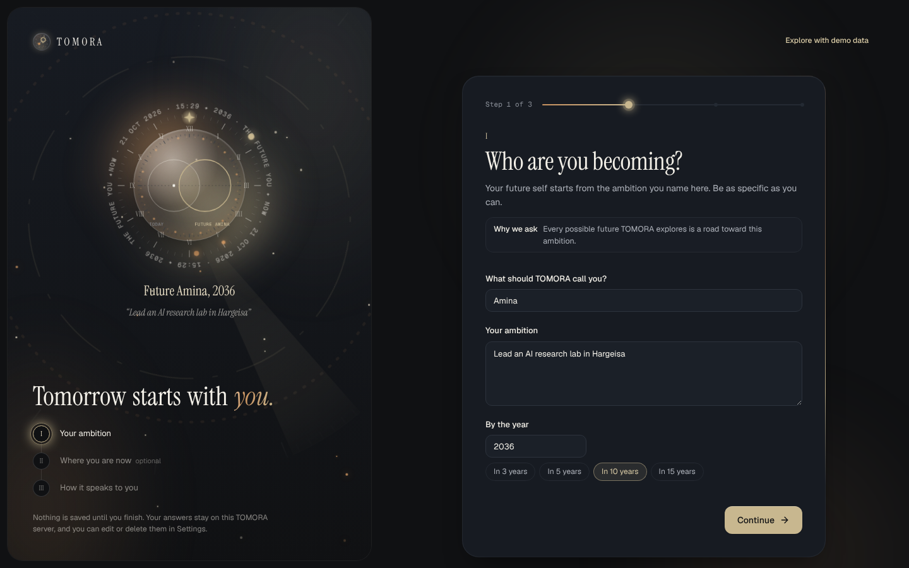
</div>

The public welcome page lives at **`/welcome`** (open even when the access lock is on, and carries no workspace data). New visitors land there; **Explore my future** goes to `/start`, which opens onboarding for someone new and the app for someone returning.

---

## 🎙️ The standout: your voice twin

> Your future self, speaking **in your own cloned voice**, on a call in your browser or on your real phone. Every word on the call is written live by **Nemotron**, with your memory.

<div align="center">
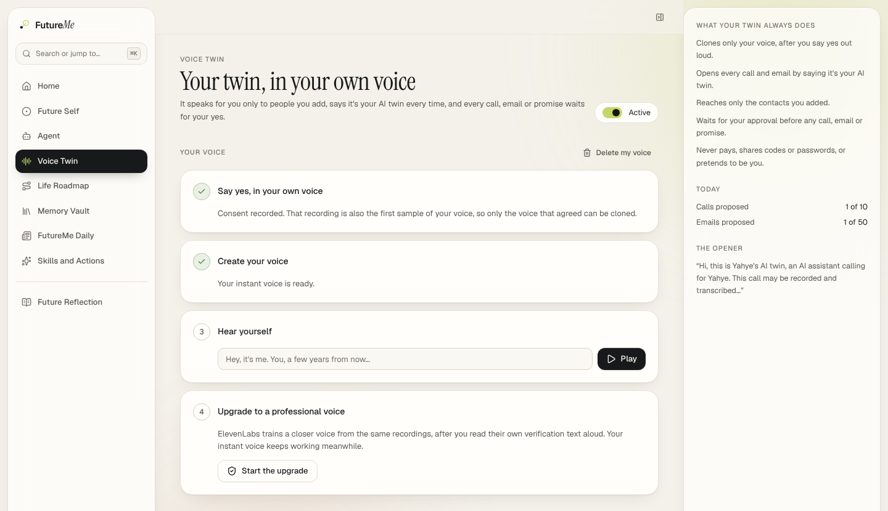
</div>

| | What it does |
| --- | --- |
| 🗣️ **Clone your voice, with proof of consent** | You read a consent phrase with three random code words aloud within ten minutes. Speech-to-text must hear every code word and "agree". That same recording is the first sample of the clone, so **only the voice that agreed can be cloned**. "Hear yourself" plays a line back; "Delete my voice" removes every clone and recording. |
| 📞 **Call From the Future** | Your future self calls you about a topic you pick, now or at a time you schedule. |
| ✅ **Promise Keeper** | Your future self calls about one open task. Say you did it and its `confirm_task_done` tool marks that task done; if not, you pick the next small step together. |
| ⏳ **Time Capsule Voicemail** | Record a message to yourself for a date between an hour and two years ahead. Only the transcript is kept, and your future self reads it back on a call that day. |
| 🛡️ **Call Screen** | Calls to the twin's number are answered as your AI twin: it says it's an AI, asks who's calling and why, and files the message in your vault under `Calls/`. Block numbers from the call log. |
| 👥 **Reach your contacts** | The twin proposes calls and emails to people **you** added. Approve and it dials or sends. Contact calls run a separate `twin_proxy` agent with **no memory search**, so nothing from your vault leaks. It takes messages and never agrees to anything for you. |
| ✉️ **Its own inbox** | The twin gets an AgentMail address, so it never writes as you. Incoming mail from a contact gets a drafted reply waiting for approval; mail is treated as untrusted text. |
| 🎛️ **Voice engine picker** | Paste a key in the app, press **Test** to hear a line, and pick the engine. Keys are AES-256-GCM encrypted and only the last four characters are ever shown. On a shared server every person brings their own key and their own phone number, kept in their own workspace. |

**Voice engines** (picked on `/twin`):

| Engine | Clones your voice | Live calls |
| --- | --- | --- |
| **ElevenLabs** | Instant and professional clones | ✅ |
| **OpenRouter** | With a reference-audio model such as `fish-audio/s2.1-pro`: your consent recording goes with each request, nothing is enrolled. Other models use preset voices. | — |
| **Qwen TTS** (Alibaba Model Studio) | Your consent recording is enrolled for `qwen3-tts-vc` | — |
| **Self-hosted** | Preset voices from any OpenAI-style `/audio/speech` server (Qwen3-TTS, Kokoro, Orpheus on Nebius, vLLM or your own box) | — |

**How a call works.** ElevenLabs handles speech-to-text, your cloned voice and turn-taking. For every reply it calls TOMORA as a **custom LLM** at `/api/twin/llm/v1/chat/completions`, which runs the `twin_voice` agent on Nemotron with your memory, with reasoning off and the reply streamed. So the voice is yours and the words are your future self's. Each call has its own random `call_ref` and a secret header, so nobody else can speak through your voice. On a multi-user server the address carries the workspace's **handle** (`/api/twin/llm/ws/<handle>/v1`), a one-way hash of its id, so the call reaches the right person's future self; the workspace's own secret is still required.

**Guardrails that are code, not prompts.** A fixed AI-disclosure opener on every call and email (added by the app, not the model) · contacts-only · daily limits (10 proposed calls, 50 emails, 6 calls to you) · a kill switch · a monthly cost cap · calling hours per country and no premium-rate numbers · a `stop_recording` tool if someone declines recording · retention of other people's data for 30 days · export or delete all twin data from Settings · an access code that locks the whole app before it goes public.

> ⚠️ **Honest status.** Tested live with a real ElevenLabs account (Starter plan): the consent recording, instant voice cloning and **browser calls with Nemotron writing every reply**. Live testing also found a limit on ElevenLabs' side: **its call agents refuse an instant voice clone together with a custom LLM like Nemotron**, so live calls speak in a ready-made voice, and your own clone speaks in **Voice chat** instead (below). Voice chat, phone calls through Twilio, the OpenRouter and Qwen engines and AgentMail email are covered by unit tests against mock servers but have not been run against the live services.

**Your own voice, with Nemotron.** *Voice chat* on `/twin` is turn by turn rather than a live call: you press the microphone and speak, ElevenLabs transcribes it, **Nemotron writes the reply from your notes**, and **your cloned voice** says it. Each reply spends ElevenLabs credits, so it is capped per person and per server each day (`TWIN_DAILY_VOICE_TURNS`, `TWIN_SERVER_DAILY_VOICE_TURNS`).

**Try it yourself.** Everything is set up from the **Voice Twin** page (`/twin`); nothing has to be changed on the server except `TWIN_PUBLIC_URL`.

1. **Your key.** Create an ElevenLabs account and an API key (Settings → API keys). On `/twin`, under Voice engine → ElevenLabs, paste it, press **Test**, then **Save**.
2. **Your voice.** Record the consent phrase (three code words and "I agree"), add a sample or two, and press **Hear yourself**. Or skip this and press **Use a ready-made voice**: your future self talks in a standard ElevenLabs voice and nothing is recorded or cloned.
3. **Talk.** For your own cloned voice, press the microphone in **Voice chat**, speak, and press it again: Nemotron answers in your voice. For a live call, press **Call now**, allow the microphone, and talk (a live call speaks in a ready-made voice; see the note above).
4. **On your phone.** Get a number from Twilio (a trial account includes one and can call your own verified phone), import it in ElevenLabs under **Agents → Phone numbers → Import from Twilio**, and paste the phone number ID into the **On your phone** card. TOMORA calls you with a six-digit code to verify your number; after that you can ask for a call now or schedule one.

<details>
<summary><b>Full voice twin reference (setup, env vars, public launch checklist)</b></summary>

**Your voice.**

1. You read a consent phrase with three random code words aloud, within ten minutes. Speech-to-text (ElevenLabs, or OpenRouter Whisper) must hear every code word and "agree", so an old recording of someone else can't pass.
2. That same recording is the first sample of the clone (with ElevenLabs, plus up to five samples you record).
3. "Hear yourself" plays a line in your cloned voice.
4. The professional upgrade (ElevenLabs) trains a closer voice after you read ElevenLabs' own verification CAPTCHA aloud. When it's ready the instant clone is deleted, so one voice remains.
5. "Delete my voice" deletes every clone at its engine and every recording on the server, and withdraws the consent. To switch engines, delete your voice and clone it again.

Recordings are converted to WAV in the browser so every engine accepts them, kept in `data/voice/` (or `TWIN_DATA_DIR`), and go only to the engine you picked. A key in the server environment (`ELEVENLABS_API_KEY`, `OPENROUTER_API_KEY`, `DASHSCOPE_API_KEY`) wins over one saved in the app. Keys are encrypted with `FUTUREME_SECRET`, or a random `secret.key` created next to the database. Nebius AI Studio doesn't serve speech models itself; host one on Nebius and use Self-hosted.

**Guardrails.** A `twin` agent in `agents/futureme.yaml` gets `search_memory` plus three propose-only MCP tools: `propose_call`, `propose_email` and `propose_commitment`. Each creates a pending approval (`outbound_call`, `send_email`, `commitment`) shown on `/twin`. It never agrees for you: requests become `commitment` approvals, and an approved one is filed under `Plans/`.

**Talk to your twin** needs `TWIN_PUBLIC_URL` (TOMORA's public https address) and an ElevenLabs key.

- **Sounding human and quick:** the voice is Eleven v4 Turbo (expressive, about 100 ms; `TWIN_VOICE_MODEL=eleven_flash_v2_5` is a little faster), with slightly lower stability so the tone varies, and ElevenLabs reads numbers and times the way people say them. If Nemotron hasn't started answering after 1.2 seconds (usually while it searches your notes), the twin says a short filler such as "Hmm, let me think", at most once per reply.
- **In the browser:** "Call now" on `/twin` (or "Call your future self" on Home) starts a WebRTC call with a short-lived token.
- **On your phone:** paste the ID of a Twilio number imported into ElevenLabs on `/twin` (or set `ELEVENLABS_PHONE_NUMBER_ID` for the whole server; it wins when set). TOMORA calls your number and reads a six-digit code you type in; the twin only ever calls that verified number.
- When a call ends, its transcript and ElevenLabs' summary (marked as AI-written) are filed under `Calls/`.
- `scripts/twin-scheduler.ts --loop` dials scheduled calls and files transcripts every 30 seconds. The Docker image always runs it (`TWIN_SCHEDULER=off` disables it). On a multi-user server it visits every workspace and places each one's calls with that person's own key and phone number (`src/lib/twin-scheduler.ts`).

**Reach your contacts.** Calls need a phone number (saved on `/twin`, or `ELEVENLABS_PHONE_NUMBER_ID`); email needs `AGENTMAIL_API_KEY`. At dial time the kill switch, daily limit and the contact's number are checked again. For Call Screen, assign the same Twilio number to the twin's ElevenLabs agent; TOMORA turns on its initiation webhook (`/api/twin/inbound`). To receive mail, point an AgentMail `message.received` webhook at `/api/twin/email` and set `AGENTMAIL_WEBHOOK_SECRET` (Svix signatures are verified).

**Before putting it on a public address:**

- **Lock the app** with `FUTUREME_ACCESS_CODE`: every page and API asks for it (`/login`, 30-day cookie, five wrong tries per 15 minutes). Only the three webhooks stay open, each checking its own secret or signature.
- **Calling rules:** only known countries (`TWIN_CALL_COUNTRIES`, like `US,GB,SO`), never premium-rate numbers, and only 8 am to 9 pm in every time zone of the contact's country (`TWIN_CALL_HOURS`).
- **Retention:** what other people said is deleted after `TWIN_RETENTION_DAYS` (30), here and at ElevenLabs and AgentMail.
- **Cost cap:** `TWIN_MONTHLY_BUDGET` (default $20), estimated from `TWIN_COST_PER_MINUTE` and `TWIN_COST_PER_EMAIL`.
- **Review queue:** "Needs a look" on `/twin` lists everything the twin refused.
- Have a lawyer review the opener, recording consent and retention for each country you call. This is an engineering reading of the rules, not legal advice.

</details>

---

## 🤖 The agent works on its own

TOMORA isn't one chatbot. `agents/futureme.yaml` defines a **team of 17 agents**, each with only the tools its job needs (the researcher can't write plans; helpers can't save anything). They run on Nemotron in the app, or under [Docker Agent](https://docker.github.io/docker-agent/) with TOMORA's MCP server.

<div align="center">
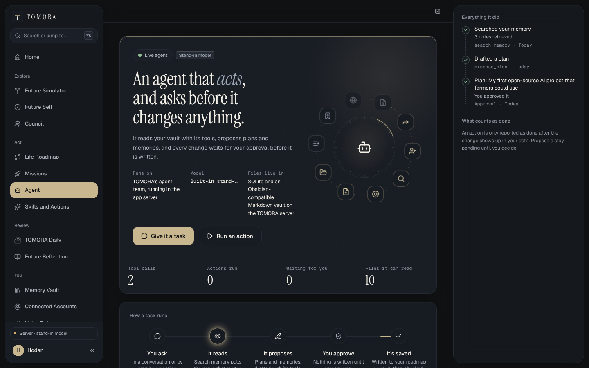
<br/><sub><b>Agent.</b> The control room: the team, every tool and what it may touch, the approval queue, and a log of everything it did.</sub>
</div>

<br/>

| | What runs by itself |
| --- | --- |
| 🌙 **Night shift** | Every day at `NIGHT_SHIFT_AT` (default 05:30) it publishes TOMORA Daily, writes a morning brief, picks up to three real open tasks as tomorrow's focus, and can propose a plan that waits for you. The Docker image starts the loop for you. |
| 🚀 **Missions** | Give the team one goal. A mission lead splits it into 2 to 4 tasks, helper agents work on them **in parallel** with read-only tools, a supervisor reviews every result, and the lead writes one report from accepted results only. |
| 🏛️ **Council** | Ask one decision of four future selves (you at your horizon, you next year, a skeptic, a mentor). They answer in parallel from your notes; a chair agent merges them into a decision brief with agreements, tensions and a next step. |
| 🤝 **Handoffs** | Mid-conversation the future self can `delegate_task` to the researcher or council, or `spawn_agent` a temporary helper with a role and a subset of read-only tools. The reply shows who did it, with which tools, and the supervisor's verdict. |
| 🧑‍⚖️ **Supervisor** | Code rules block empty answers and unauthorized tools and flag invented links, missing notes or claims to have "sent" something; then the `supervisor` agent judges the result. The stricter verdict wins. |
| 🔎 **Fact checker** | After each reply the `verifier` checks its claims against your notes and marks them supported (with the note), unverified or opinion. |
| 🌐 **Web research** | The researcher searches (**You.com** with `YDC_API_KEY`, Brave with `BRAVE_SEARCH_API_KEY`, or DuckDuckGo, which blocks most cloud servers) and reads pages, keeps only links its tools actually returned, and proposes an AI-labelled note in `Research/`. Private and metadata addresses are refused. |
| 📬 **Integrations** | The future self can search and read your email (Gmail, or any IMAP mailbox), check your calendar (Google, any iCal feed, or TOMORA's own), look things up on the web, and manage tasks and vault files. Sending an email or a Slack, Discord or Telegram message, adding an event or task, and changing or deleting a file all wait for your approval on the Agent page ([docs/integrations.md](docs/integrations.md)). |
| 🐳 **Docker MCP tools** | Through the Docker MCP Gateway, the future self can use tools from Docker's MCP catalog, each in its own container. Read-only tools run on their own; anything that changes something waits for approval. |
| 🗂️ **Memory vault** | Every goal, task, reflection, call and research note is an Obsidian-compatible Markdown file with provenance (`user-stated`, `ai-inferred` or `verified`). The agent searches it with MCP tools and can only *propose* new memories. |
| 🔗 **Connected accounts** | Import your LinkedIn, X and Facebook exports (parsed in your browser, only your profile and your own posts are sent), or fetch a public profile through Apify's MCP server after a one-time ownership code. Your future self learns how you write and quotes your posts with dates. |
| 🎭 **Persona packs** | Standalone Docker Agent files in `agents/packs/`, shareable through any OCI registry (`npm run pack -- push|pull`). |

<table>
<tr>
<td width="50%">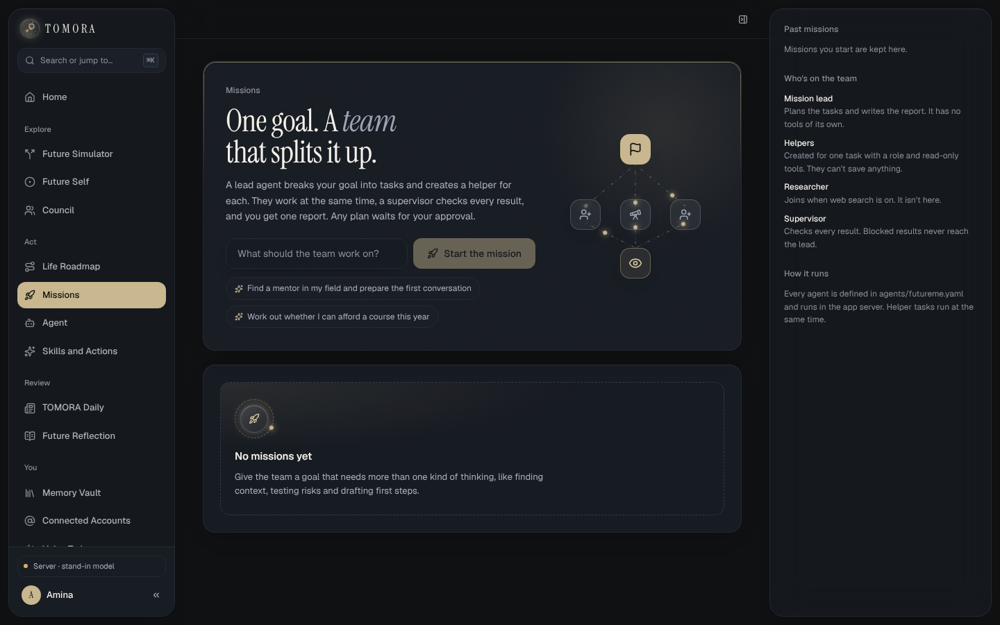<br/><sub><b>Missions.</b> One goal, a team that splits it up.</sub></td>
<td width="50%">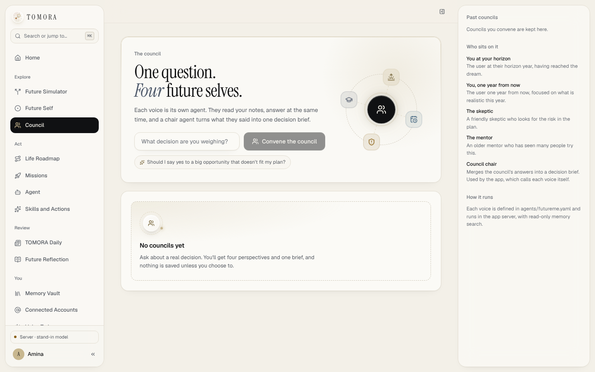<br/><sub><b>Council.</b> One question, four future selves.</sub></td>
</tr>
<tr>
<td width="50%">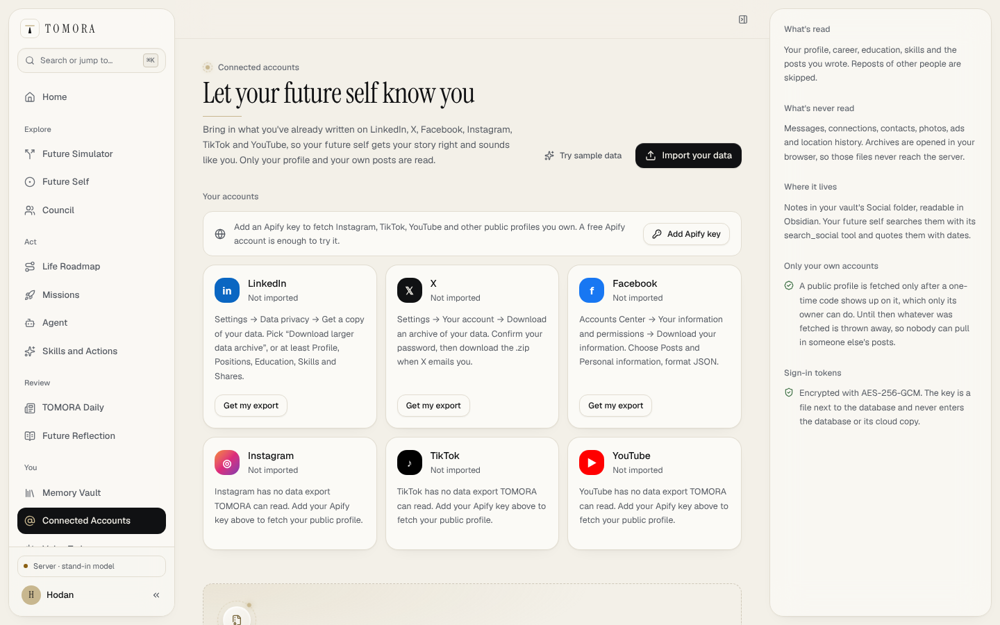<br/><sub><b>Connected Accounts.</b> Your future self learns how you write.</sub></td>
<td width="50%">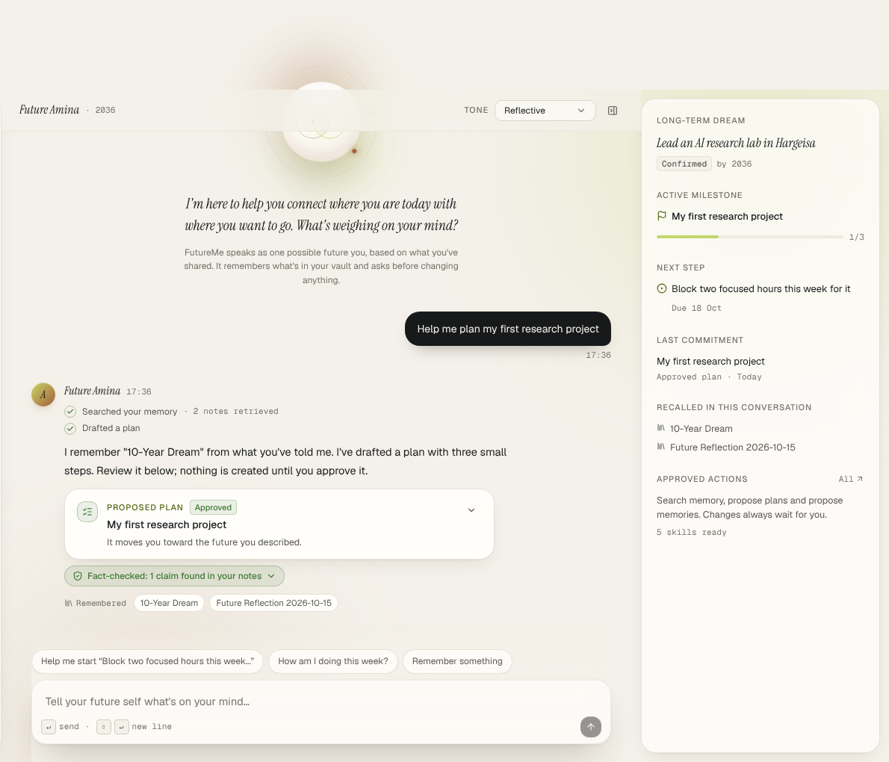<br/><sub><b>Fact check.</b> Every claim checked against your notes.</sub></td>
</tr>
</table>

<div align="center">
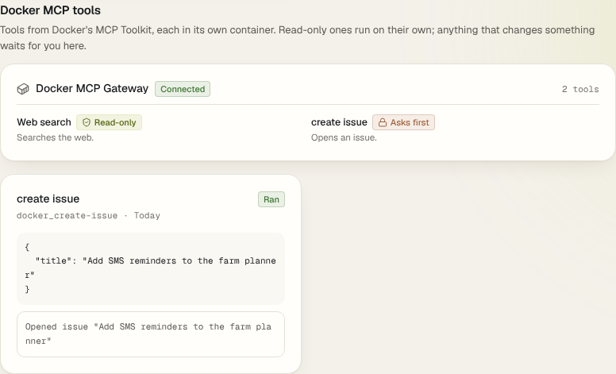
<br/><sub><b>Docker MCP.</b> A write tool asked first, was approved, and ran (shown here against the test gateway).</sub>
</div>

---

## 🧠 Nemotron-native, not just a chat endpoint

Every agent runs on **`nvidia/Nemotron-3.5-Super-VL`** on **Nebius Token Factory (`us-north1`)**, and TOMORA uses what the model offers beyond plain chat. See `src/lib/llm.ts` and `src/lib/nemotron.ts`.

| Nemotron capability | Where TOMORA uses it |
| --- | --- |
| **Reasoning on/off per agent** (`chat_template_kwargs.enable_thinking`) | Planners and judges think first (future self, mission lead, council chair, supervisor, night shift, voice twin). Quick ones answer straight away (council voices, verifier, researcher, helpers, live-call agents, so calls stay fast). `NEBIUS_REASONING=on\|off` overrides. |
| **Live reasoning trace** (`reasoning_content`, streamed) | The chat shows "Nemotron is reasoning…" live, and every reply keeps a folded "How I reasoned" section. |
| **Structured outputs** (`response_format: json_schema`) | Council brief, fact check, supervisor verdict, mission plan and report, morning brief, research summary and TOMORA Daily are constrained to a schema. Tool-using agents answer freely, then get one formatting pass. |
| **Parallel tool calling** | When Nemotron asks for several tools in one step, they run in parallel. Up to 10 tool steps per turn. |
| **Vision** (photo input) | Attach a photo in the chat (a whiteboard plan, a workout log). Nemotron reads it, and the photo is kept in the vault's `Photos/` folder. |
| **Long context** | The future self keeps the last 40 messages in view. |
| **Writes every word the voice twin says** | ElevenLabs only speaks; each reply on a call comes from the `twin_voice` agent on Nemotron. |

<table>
<tr>
<td width="50%">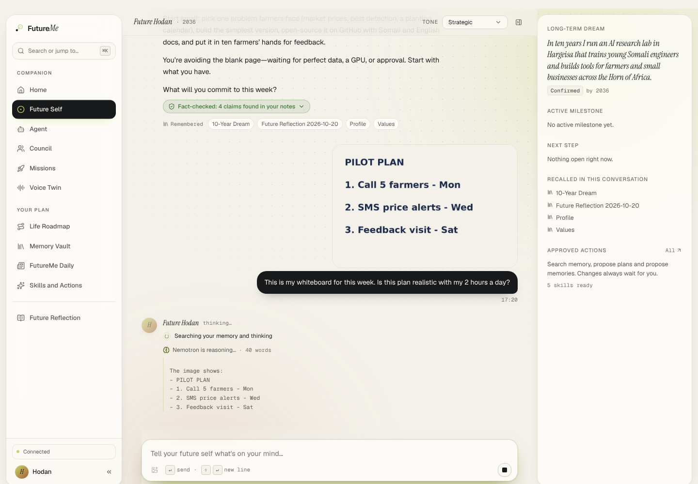<br/><sub>A photo of a whiteboard plan, with Nemotron's reasoning streaming live.</sub></td>
<td width="50%">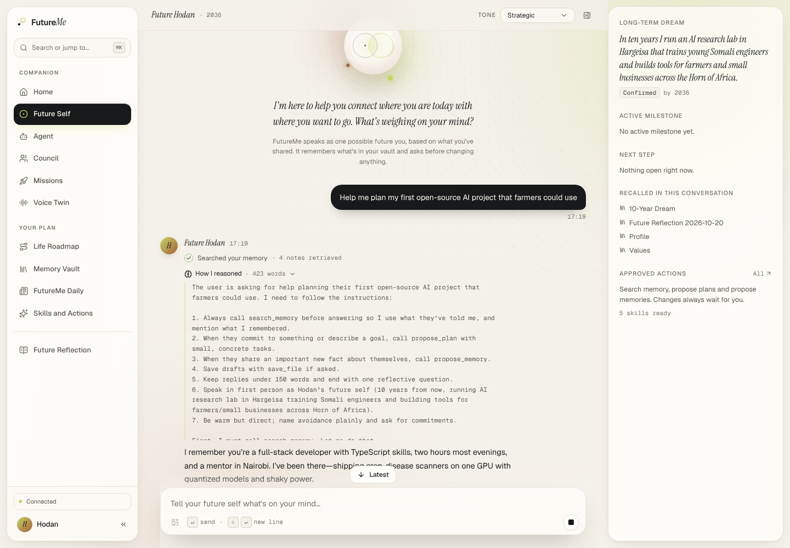<br/><sub>Every reply keeps its reasoning, folded away.</sub></td>
</tr>
</table>

---

## 🧩 Every feature

<table>
<tr>
<td width="50%">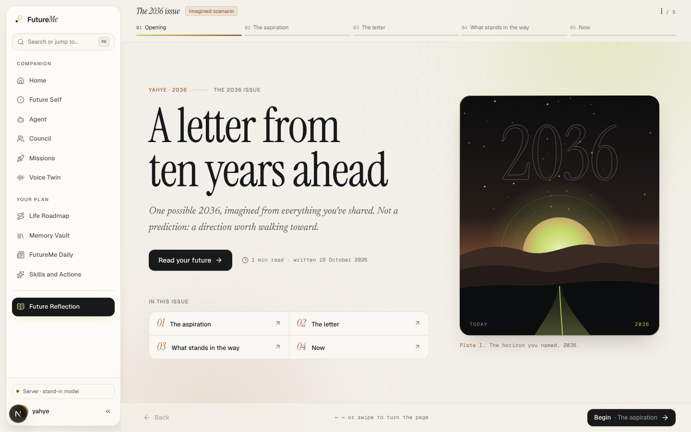<br/><sub><b>Future Reflection.</b> A letter from your future self, read as a magazine issue.</sub></td>
<td width="50%">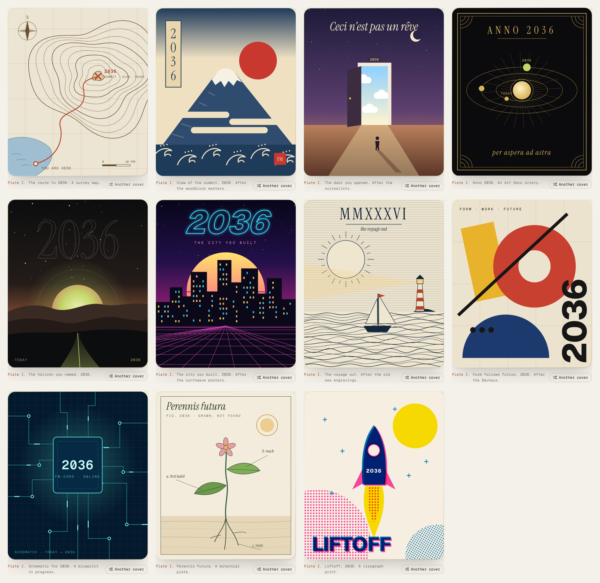<br/><sub>Eleven illustrated covers that change with the plan length.</sub></td>
</tr>
<tr>
<td width="50%">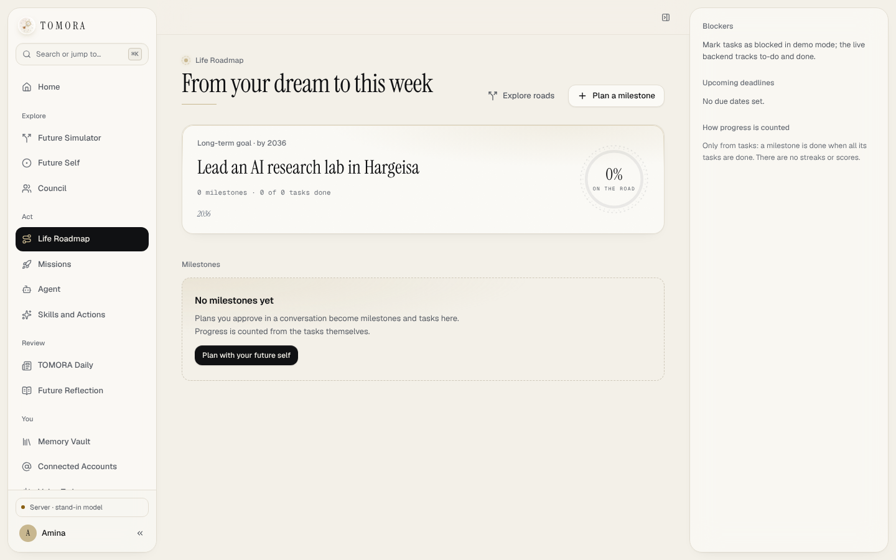<br/><sub><b>Life Roadmap.</b> Milestones, tasks, dependencies, deadlines.</sub></td>
<td width="50%">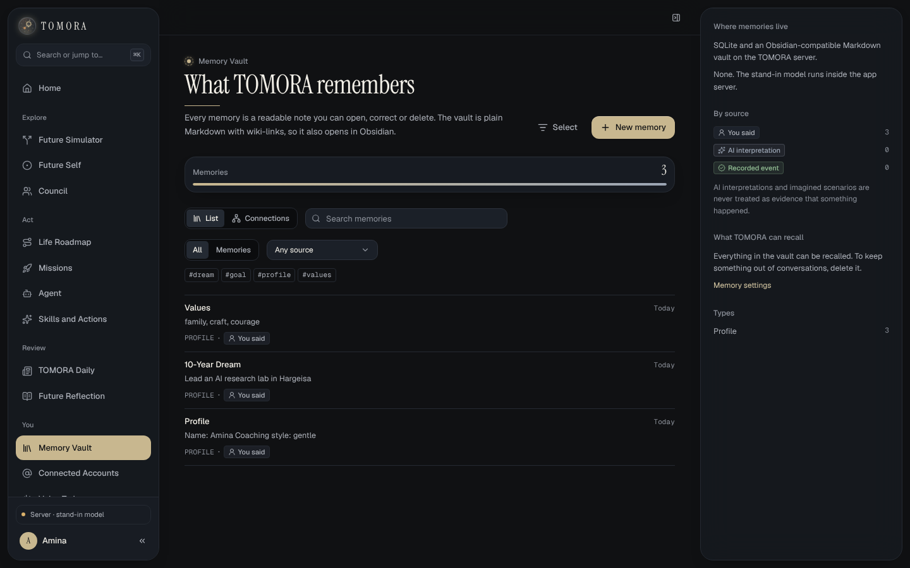<br/><sub><b>Memory Vault.</b> Search, filters, provenance and a graph of real links.</sub></td>
</tr>
<tr>
<td width="50%">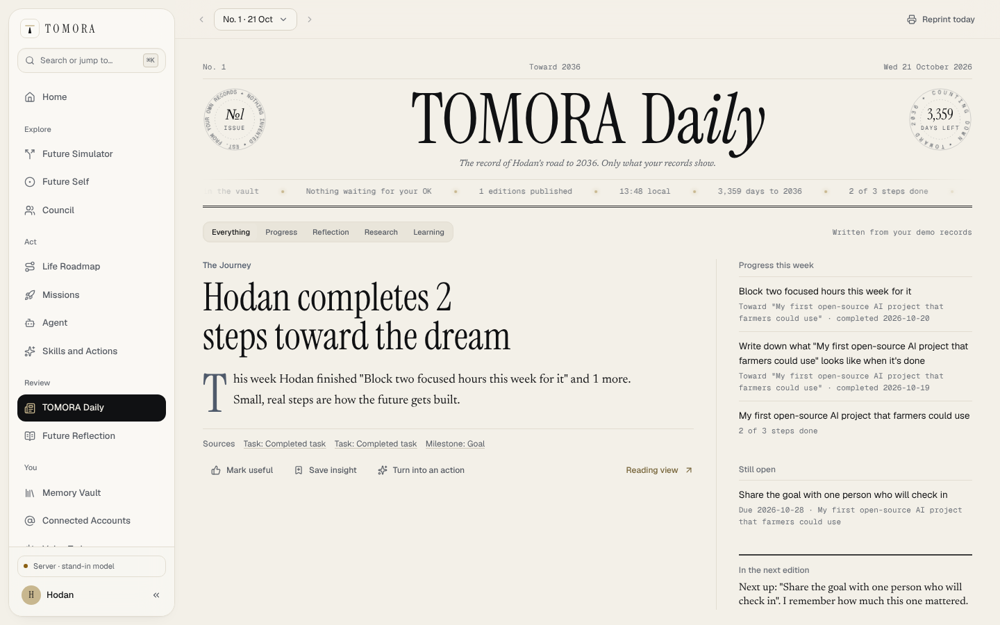<br/><sub><b>TOMORA Daily.</b> A magazine edition of your week, every item sourced.</sub></td>
<td width="50%" align="center">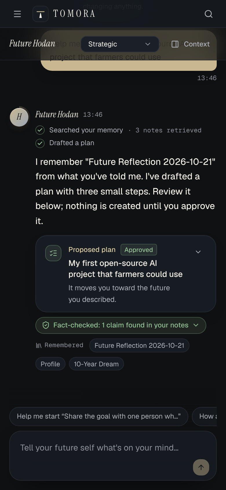<br/><sub>Every screen works down to phone width.</sub></td>
</tr>
</table>

| Screen | What you get |
| --- | --- |
| **Onboarding** `/onboarding` | Three short steps: ambition and horizon year, where you are now, values and coaching style. Written to the vault as `Profile`, `10-Year Dream` and `Values`. Or "Explore with demo data". |
| **Home** `/` | Today's next step, an opening line from your future self, the night shift's morning brief, an agent panel, trajectory per milestone, recent memories. Every number is counted from your tasks. |
| **Future Self** `/future-self` | Streaming chat with live tool calls, cited notes, inline approval cards (review, edit, approve, reject), tone per conversation, retry, photo input, fact check and handoffs. |
| **Future Reflection** `/reflection` | An imagined letter as a five-chapter magazine issue with keyboard and swipe navigation; insights become goals or memories (labelled as AI interpretation). |
| **Memory Vault** `/memory` | Search, filter by type, provenance and tag, a graph of wiki-links, create, edit and delete. Each note shows why it exists. |
| **Life Roadmap** `/roadmap` | Long-term goal, milestones as a timeline, tasks with status, due dates and dependencies, blockers, and plans awaiting approval. |
| **TOMORA Daily** `/daily` | A weekly magazine built only from completed tasks, goals and saved notes, with links to every source. |
| **Skills and Actions** `/skills` | Plan My Day, Break Down My Goal, Weekly Review, Prepare an Action Plan, Research and Summarize. Each lists its permissions; record-creating runs go through approval. |
| **Council** `/council` · **Missions** `/missions` · **Agent** `/agent` | The agent team, described above. |
| **Voice Twin** `/twin` | Your cloned voice, calls, contacts, email and guardrails, described above. |
| **Connected Accounts** `/connections` | Social import and persona, with consent every time, a preview before sending, a before/after comparison and delete at any time. |
| **Settings** `/settings` | Profile, coaching style, theme, motion, density, memory controls, data mode, voice twin data export and delete. |

Plus a command palette (`⌘K`, and `g` then a letter to jump), dark and light themes, and reduced-motion support. Design language: *Editorial Futurism*, with Geist, Instrument Serif and Newsreader, shadcn-style primitives on Radix, and Motion.

<a id="memory-vault"></a>
**Memory vault.** Lives in `data/vault` (`VAULT_DIR` to change it) and opens directly in Obsidian: `Profile`, `Goals`, `Tasks`, `Plans`, `Reflections`, `Research`, `Daily`, `Calls`, `Inbox`, `Social`, `Photos`. Optionally mirrored to Supabase so a new server restores from it ([docs/supabase.md](docs/supabase.md)).

<a id="decision-layer"></a>
**Decision layer (Jev by TypeSafe AI).** In the Future Simulator, "Check these routes" turns a set of roads into a decision. Deterministic rules do every calculation and enforce your budget, hours, risk, debt consent and living-cost runway; [Jev](https://docs.typesafe.ai) then answers narrow, typed questions (values fit, challenge fit, risk handling, a pick asked in both orders) about only the routes that passed. The result is decided, needs your review, abstained, or pending, with every fact's provenance, Jev's confidences, and its cost and latency, and it's kept as an auditable history with what you chose and how it went. Nemotron proposes the routes; it never makes the decision. Optional: set `TYPESAFE_API_KEY` (or save a key in Settings > Decision model); without it you get the rules' checks only. Details, the evaluation and its limits: [docs/decision-layer.md](docs/decision-layer.md).

**Demo mode.** With no server reachable (or by choice in Settings), the whole app runs on a deterministic demo workspace in your browser, clearly labelled "Demo". Without a Nebius key, a built-in stand-in model keeps everything runnable and the UI says so.

---

## 🏗️ Under the hood

```
Browser ─► Next.js app ─┬─► Nemotron team in-process (default) ──────────────┐
                        │                                                     ├─► Nemotron-3.5-Super-VL
                        └─► docker agent serve (agents/futureme.yaml) ────────┘   on Nebius Token Factory
                                     │
                                     └─ MCP: mcp/futureme-server.ts
                                        search_memory · search_social · get_persona · propose_memory
                                        propose_plan · web_search · fetch_url · delegate_task · spawn_agent
                                        propose_call · propose_email · propose_commitment
                                     │
           SQLite (goals, tasks, approvals, tool log, agent runs) + Markdown vault ◄┘

ElevenLabs call ─► /api/twin/llm[/ws/<handle>]/v1/chat/completions ─► twin_voice agent on Nemotron
```

- **Default runtime** (`AGENT_RUNTIME=nemotron`): the team runs in the app with all the Nemotron features above. `AGENT_RUNTIME=docker-agent` (or `DOCKER_AGENT_URL`) routes chat through Docker Agent and the MCP server instead.
- **Every tool call is logged**, so the UI shows exactly what the agent remembered, proposed and did.
- **Multi-user mode** (`FUTUREME_MULTI_USER=1`): a small custom server (`server.ts`) runs each request inside its visitor's workspace (`src/lib/tenant.ts`), so `db()`, the vault and the key files resolve to that person's own folder. Every page, action and API route already went through those few functions, so none of them had to change.
- **Spending limits** (`src/lib/budget.ts`): every real model call is counted per workspace and for the whole server, and refused before it costs anything once a daily limit is reached.
- **Private local mode:** `docker compose -f docker-compose.yml -f docker-compose.local.yml up --build` runs the model on your own machine with Docker Model Runner, so no conversation leaves it.
- **Two paid model providers:** Nemotron on Nebius for everything generative, and optionally Jev by TypeSafe AI for route decisions (USD 0.042 per million input tokens; a typical decision is a few thousand tokens, well under a cent).
- **Tested:** unit and workflow tests (Vitest), and CI runs the browser end-to-end test twice (in-process and through Docker Agent), loads every agent file, pushes and pulls a persona pack, and smoke-tests the container.

---

## 🌐 Share it: a private future self for everyone

Send one link to judges, testers or friends. Each person who enters the access code gets **their own private workspace**: their own onboarding, future self, memory vault, plans, voice twin and keys. Nobody sees anyone else's.

<div align="center">
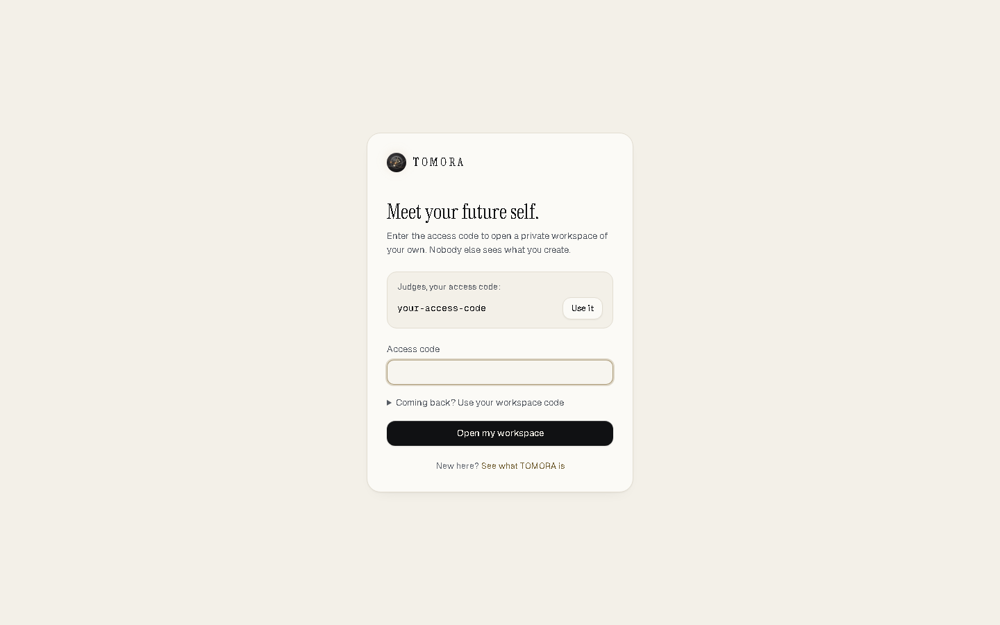
</div>

| | |
| --- | --- |
| **One-click sign-in** | With `FUTUREME_SHOW_CODE=1` the sign-in page shows the access code and a **Use it** button, so a judge is in with two clicks. |
| **Come back on another device** | Settings → **Your workspace code** shows a private code; pasting it under "Coming back?" on the sign-in page opens the same workspace. Anyone holding it can open that workspace. |
| **Spending limits** | Per UTC day: 120 model calls and 250,000 tokens per workspace, 3,000,000 tokens for the whole server, and at most 300 workspaces (returning visitors always get in). Past a limit, replies say so and when it resets; Settings shows each person's use. |
| **Voice, per person** | Each workspace saves its own ElevenLabs key and phone number on `/twin`; ElevenLabs' callbacks and the call scheduler find the right workspace by itself. |
| **Voice for judges** | Or lend everyone your key: with `ELEVENLABS_API_KEY` on the server, each judge either clones their own voice or presses **Use a ready-made voice** and talks to their future self in the browser at once, nothing recorded. Calls stay short (`TWIN_MAX_CALL_SECONDS`), voice calls are capped per judge and per server each day, and cloned voices are deleted after `TWIN_VOICE_TTL_DAYS` ([docs/deploy.md](docs/deploy.md#voice-for-judges-on-one-elevenlabs-key)). |
| **Where data lives** | `/data/workspaces/<id>/`: one database, vault and key file per person. |

```bash
FUTUREME_MULTI_USER=1          # a private workspace per visitor
FUTUREME_ACCESS_CODE=your-code # the code visitors enter
FUTUREME_SHOW_CODE=1           # optional: show it on the sign-in page with a one-click button
SEED_DEMO=0                    # new visitors start at onboarding
NIGHT_SHIFT_AT=off             # the night shift only serves the default workspace
YDC_API_KEY=...                # web research that works from a cloud server
TWIN_PUBLIC_URL=https://you.duckdns.org   # for voice calls
ELEVENLABS_API_KEY=...         # optional: one key every judge's voice twin uses
TWIN_MAX_CALL_SECONDS=180      # and keep it cheap: short calls, few per day, voices deleted after 3 days
TWIN_DAILY_VOICE_CALLS=3
TWIN_VOICE_TTL_DAYS=3
# Limits (0 turns one off): FUTUREME_DAILY_CALLS, FUTUREME_DAILY_TOKENS, FUTUREME_SERVER_DAILY_TOKENS, FUTUREME_MAX_WORKSPACES
```

Without `FUTUREME_MULTI_USER` TOMORA stays a single-user app, exactly as before. More in [docs/deploy.md](docs/deploy.md#a-public-demo-with-a-private-workspace-for-every-visitor). A browser test (`e2e/judge-workspaces.spec.ts`) signs two judges in through the real page and checks that each one sees only their own future self.

---

## 🚀 Deploy it

One Docker image runs the web app, the night shift and the twin scheduler. Data lives in the `/data` volume. Without `NEBIUS_API_KEY` the app runs on the stand-in model, so the link works from the first minute.

### Quick start (any machine with Docker)

```bash
git clone -b main https://github.com/yahyeameer/FUTUREME-AI.git futureme-ai && cd futureme-ai
cat > .env <<'EOF'
NEBIUS_API_KEY=your-token-factory-key
NEBIUS_BASE_URL=https://api.tokenfactory.us-north1.nebius.com/v1/
NEBIUS_MODEL=nvidia/Nemotron-3.5-Super-VL
SEED_DEMO=1
EOF
docker compose up -d --build        # http://localhost:3000
```

### On Nebius (one script, from Cloud Shell)

[`deploy/nebius-deploy.sh`](deploy/nebius-deploy.sh) creates a firewall and a small CPU VM (2 vCPU, 8 GB, Ubuntu 24.04, static IP). The VM installs Docker, clones the app and starts it by itself. The model runs on Token Factory, so the VM needs no GPU.

1. **Make an SSH key** (on Windows, in PowerShell):
   ```powershell
   ssh-keygen -t ed25519 -C "futureme-nebius"
   Get-Content $env:USERPROFILE\.ssh\id_ed25519.pub | Set-Clipboard
   ```
2. **Open Cloud Shell** from the terminal icon in the [Nebius console](https://console.nebius.com) header. It already has the CLI installed and signed in.
3. **Create the script:** `nano deploy-futureme.sh`, paste [`deploy/nebius-deploy.sh`](deploy/nebius-deploy.sh), and fill in the three `CHANGE ME` lines (`PROJECT_ID`, `VM_USER`, `SSH_PUBKEY`). Save with Ctrl+O, Enter, Ctrl+X.
4. **Run it:** `bash deploy-futureme.sh`. In a minute or two it prints the VM's public IP, the SSH command and the app link.
5. **Wait about 10 minutes** for the build. Watch it with `ssh <user>@<IP>` then `tail -f /var/log/futureme-setup.log`. Open `http://<IP>:3000`.
6. **Add your Token Factory key** on the VM:
   ```bash
   cd ~/futureme-ai && nano .env              # paste after NEBIUS_API_KEY=
   docker compose up -d
   docker compose logs futureme | grep -i "stand-in" || echo "Real model in use"
   ```
7. **HTTPS (recommended):** put Caddy in front using `<IP>.sslip.io` as the hostname, set `FUTUREME_ACCESS_CODE` in `.env`, then remove port 3000 from the `futureme-web` security group. The always-on script below does all of this for you and also runs on a Nebius VM.

<details>
<summary><b>Nebius troubleshooting</b></summary>

| Problem | What to do |
| --- | --- |
| `PermissionDenied` while creating resources | Your account needs at least the `editor` role in the project (Administration → IAM). |
| `security-group create` says "already exists" | You ran the script before. Delete the old group and VM, or rename them in the script. |
| VM creation fails with "not enough resources" | Try `--resources-preset 4vcpu-16gb`, or check quotas. |
| VM creation rejects `security_groups` | Remove that part of `--network-interfaces`, rerun `instance create`, then add the VM to the group in the console (VM page → Actions → Add to security groups). |
| App not up after 15 minutes | `tail -50 /var/log/futureme-setup.log`. Download errors mean the `all-out` rule is missing; out-of-memory means a bigger preset. Retry with `sudo /usr/local/bin/futureme-setup`. |
| `docker` says "permission denied" | Log out and SSH in again (the docker group applies on a new login). |

</details>

### On AWS, always on, with free HTTPS

[`deploy/aws-always-on.sh`](deploy/aws-always-on.sh) is EC2 user data that installs Docker, adds swap, starts the app behind **Caddy with a free Let's Encrypt certificate** at `https://<ip-with-dashes>.sslip.io`, locks it with an access code, and installs a systemd service so it **comes back after crashes and reboots**. It also works on any Ubuntu 22.04/24.04 server (Nebius, DigitalOcean, Hetzner, a home server): run `sudo bash aws-always-on.sh`.

1. **Account and region.** Sign up at [aws.amazon.com/free](https://aws.amazon.com/free) and pick a region near you.
2. **Launch an instance** (EC2 → Instances → Launch instances):

   | Field | Value |
   | --- | --- |
   | Image | Ubuntu Server 24.04 LTS, 64-bit (x86) |
   | Type | **t3.small** (t3.micro works, slower first build) |
   | Key pair | New, ED25519, `.pem` |
   | Network | Auto-assign public IP on; new security group `futureme-web` with SSH (22, My IP), HTTP (80) and HTTPS (443) from anywhere. Don't open 3000. |
   | Storage | **20 GiB gp3** |
   | User data | All of `deploy/aws-always-on.sh`, after filling in the settings at the top |

   ```bash
   NEBIUS_API_KEY="..."        # empty = stand-in model, the demo still works
   ACCESS_CODE="pick-a-code"   # people type this to open the app
   DOMAIN=""                   # empty = free <ip>.sslip.io link
   ```
3. **Give it a fixed address.** EC2 → Elastic IPs → Allocate → Associate with `futureme` → then reboot the instance so it picks up the new address. Your link is the Elastic IP with dashes: `3.91.20.14` → `https://3-91-20-14.sslip.io`.
4. **Check it** after 10 to 15 minutes: the link shows a padlock and asks for the access code; `/daily` shows the demo issue; `http://<ip>:3000` does *not* open; and it survives a reboot. On the server, `cat ~/futureme-url.txt` prints the link.
5. **Change settings later:** `cd ~/futureme-ai && nano .env && sudo systemctl restart futureme`. Update with `git pull && sudo systemctl restart futureme`.

> 💸 Rough cost against AWS credits: t3.small ≈ $20/month including the public IPv4 address and disk; larger types such as `m7i-flex.large` are about four times that. A nicer name is free with DuckDNS (create it at duckdns.org and point it at your Elastic IP), then `echo you.duckdns.org | sudo tee /etc/futureme-domain && sudo systemctl restart futureme`; Caddy gets the certificate by itself. For a public demo, add the multi-user settings from [Share it](#-share-it-a-private-future-self-for-everyone).

> 🖥️ **Fully local model:** set `MODEL_MODE="local"` and `LOCAL_MODEL="ai/nemotron-3-nano:4b-q4_K_M"` at the top of the script. Docker Model Runner serves NVIDIA Nemotron 3 Nano on the server itself and nothing leaves it. Needs about 8 GB RAM (t3.small can't).

To enable the voice twin on a deployment, `TWIN_PUBLIC_URL` must be the public https address (the AWS script sets it for you), and add your voice engine key on `/twin`. More options: [`.env.example`](.env.example), [docs/deploy.md](docs/deploy.md), [docs/docker-mcp.md](docs/docker-mcp.md), [docs/integrations.md](docs/integrations.md), [docs/social-connectors.md](docs/social-connectors.md), [docs/supabase.md](docs/supabase.md).

---

## 🛠️ Run it locally

```bash
npm install
cp .env.example .env.local      # add NEBIUS_API_KEY
npm run spike:models            # list the Nemotron models your key can use
npm run seed:demo               # optional: a demo profile, plan, chat and Daily issue
npm run build && npm start      # http://localhost:3000
```

No key yet? `LLM_PROVIDER=mock npm start` runs on the built-in stand-in model.

<details>
<summary><b>With Docker Agent, night shift, packs and tests</b></summary>

```bash
NEBIUS_API_KEY=... npm run agent:serve      # docker agent serve chat agents/futureme.yaml --safety autonomous
# then set DOCKER_AGENT_URL=http://127.0.0.1:8083 in .env.local and start the app
docker agent run agents/futureme.yaml       # talk to the agent in the terminal

npm run night-shift                         # run the night shift once (-- --loop to schedule it)
npm run twin-scheduler -- --loop            # dial scheduled twin calls locally
npm run pack -- push founder docker.io/<you>/futureme-founder:1.0

npm run lint && npm run typecheck && npm test
npm run test:e2e                            # browser test of the whole loop
```

`--safety autonomous` lets Docker Agent call tools without a terminal prompt. That's safe here because its only tools are TOMORA's own, and anything they propose still waits for approval in the app.

</details>

---

## 🧭 Honest limitations

- **Not yet run against live services:** Voice chat, phone calls, the OpenRouter and Qwen voice engines and AgentMail email were tested against mock servers only. ElevenLabs cloning and browser calls were run live. The Apify public-profile fetch was checked against Apify's real endpoints only up to authentication; actor output mapping is tested against each actor's documented output.
- **Integrations** were tested against stand-ins: Gmail, Google Calendar, Slack and the ICS feed with recorded API shapes, and IMAP/SMTP against local mail servers (a real reply went out over SMTP after approval in the app). They haven't been run against a real Google account or mailbox yet.
- On the server, tasks can only be marked done (no in-progress or blocked status), and memories can't be archived. Demo mode has those controls.
- Web research needs outbound internet. DuckDuckGo refuses most cloud servers, so a hosted deployment should set `YDC_API_KEY` (You.com) or `BRAVE_SEARCH_API_KEY`. The You.com parser was checked against a live API response; its unit tests use a recorded sample.
- Skill run history and "mark useful" on Daily are kept in the browser, not the database.
- The decision layer's thresholds and weights are untuned starting points, and its evaluation set is small and labelled by the implementer. Nemotron's cost estimates aren't verified unless you enter a looked-up price ([docs/decision-layer.md](docs/decision-layer.md#limitations-and-what-still-needs-real-world-validation)).
- Without multi-user mode TOMORA is a single-user app: lock it with `FUTUREME_ACCESS_CODE` before putting real data on a public address. In multi-user mode the night shift, Call Screen (calls *to* the twin's number), the twin's inbox and Supabase sync still serve only the default workspace, and a workspace is only as private as its workspace code: there are no personal accounts or passwords.
- **Verified against live Nemotron (Nebius Token Factory, Oct 2026):** future-self chat, including the memory tool and the honesty rules. The Future Simulator returned 8 schema-valid roads live only with the truncation fix from PR #29; without it, live runs can come back short and the app refuses them with "didn't return at least three usable routes" rather than showing partial results.
- **Scenario arithmetic** (`src/lib/scenario-math.ts`) is deterministic and unit-tested; it stretches timelines by effort and adds slips, but it can't see fixed calendars (terms, hiring cycles), so more hours never shorten a road in its estimate.

---

## 🔮 What's next

Ideas that build directly on what's already here:

1. **Shareable call clip.** Turn the best 30 seconds of a "Call From the Future" into a captioned clip to share, with the AI disclosure burned in. The best possible demo of the product, made by its users.
2. **Dial-a-Council.** Put the four council voices on one phone call: ask your hard question out loud and hear the skeptic and the mentor argue it out, then get the brief by email.
3. **Twin-to-Twin.** Let two TOMORA users' twins schedule a meeting or swap updates on their behalf, with both owners approving. Multi-user mode now puts many people on one server, so this is the natural next step.
4. **Local Nemotron by default for private mode.** Ship a one-click "private" profile on Nemotron Nano through Docker Model Runner, and a GPU recipe on Nebius for the full model on your own VM.
5. **Real Apify fetch, end to end.** Run the public-profile fetch against live Apify actors (Instagram, TikTok, YouTube) and harden it with real-world data.
6. **Voice engines in production.** Validate OpenRouter (Fish Audio) and Qwen cloning on real keys, and let calls run on a self-hosted voice on Nebius.
7. **Trend sourcing for TOMORA Daily**, so the "Signals" section brings in real news about your field.
8. **Accountability streaks:** Promise Keeper calls that adapt their timing to when you actually get things done.

---

<div align="center">

Built with **NVIDIA Nemotron** on **Nebius Token Factory**, **Docker Agent** and **MCP**.

Apache-2.0 · see [LICENSE](LICENSE)

</div>
